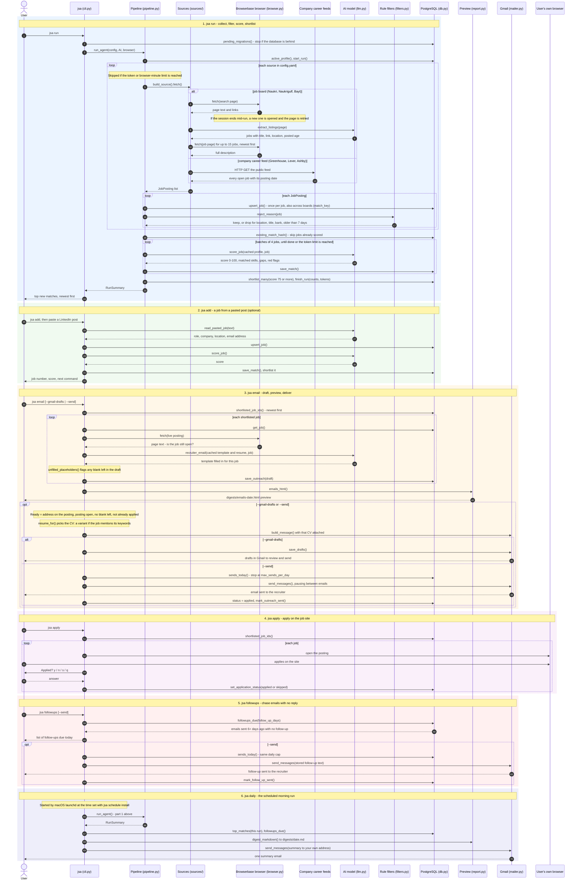

# Architecture

How the job search agent works from end to end. For what each command does, see
[GUIDE.md](GUIDE.md). For pictures you can open in a browser, see `app-flow.html` (flowchart) and
`architecture-live.html` (animated).

## Full application flow

The diagram follows one job from being found to being followed up. It has six parts, one per
command: `jsa run`, `jsa add`, `jsa email`, `jsa apply`, `jsa followups` and `jsa daily`. The parts
share only the database: each one reads what an earlier one stored.

Not in the diagram:

- `jsa web` is a separate, long-running page: `web.py` serves `http://127.0.0.1:8765`, reads
  `dashboard_rows()` for each view, and its forms post back to change status, save a note or an
  edited draft, send a stored draft, or add a pasted post.
- `jsa contacts` runs between parts 1 and 3: the AI web-searches for a published application
  address, `contacts.py` verifies it on the company's page, and `save_contact()` stores it for
  `jsa email` to use.
- `jsa gaps`, `jsa progress` and `jsa dedupe` only read (or tidy) the database.
- After `jsa run` and `jsa daily`, `notifier.py` sends jobs scoring 85 or more to Telegram or email.

## Reading the diagram

| Part | Command | What it leaves behind |
|---|---|---|
| 1 | `jsa run` | Jobs, scores and a shortlist in the database |
| 2 | `jsa add` | One more shortlisted job, from text you pasted |
| 3 | `jsa email` | A draft per job, an HTML preview, and optionally Gmail drafts or sent emails |
| 4 | `jsa apply` | The status of each job you applied to on its site |
| 5 | `jsa followups` | A follow-up sent, and recorded, for each email that got no reply |
| 6 | `jsa daily` | Part 1, plus a digest file and one summary email to you |

## The pieces

| Piece | File | Role |
|---|---|---|
| `jsa` commands | `src/jobagent/cli.py` | Reads the command and drives everything else |
| Pipeline | `src/jobagent/pipeline.py` | One run: collect, store, filter, score, shortlist, within the spending limits |
| Sources | `src/jobagent/sources/` | Job boards through the browser (`generic.py`); company career feeds over plain HTTP (`ats.py`) |
| Browser | `src/jobagent/browser.py` | A Browserbase session, or local Chromium, behind one `fetch()`; counts the minutes used |
| AI model | `src/jobagent/llm.py`, `llm_anthropic.py` | Every AI task: read pages, score jobs, read pasted posts, draft emails, with the resume and template sent as a cached prefix |
| Rule filters | `src/jobagent/filters.py` | Free checks before any AI call |
| Database | `src/jobagent/db.py`, `migrations/` | PostgreSQL: jobs, scores, applications, send times, runs |
| Preview | `src/jobagent/report.py` | Terminal tables, the Markdown digest, the HTML email preview |
| Gmail | `src/jobagent/mailer.py` | Builds the message; saves it to Drafts or sends it |
| Web page | `src/jobagent/web.py` | A local page of the shortlist: edit and send drafts, add pasted posts, notes, status |
| Shared actions | `src/jobagent/actions.py` | Add a pasted job and send a stored draft, used by both the commands and the web page |
| Contact check | `src/jobagent/contacts.py` | Confirms a found application address is printed on the company's own page |
| Notifications | `src/jobagent/notifier.py` | Sends strong new matches to Telegram, or to your own email |
| Schedule | `src/jobagent/scheduler.py` | The macOS launchd job that runs `jsa daily` each morning |
| Data shapes | `src/jobagent/models.py` | `JobPosting`, the keys for matching a job across boards, and the AI's structured answers |
| Settings | `src/jobagent/config.py` | `.env` secrets and `config.yaml`, including limits and CV variants |

## Design points

- **`JobPosting` is the one shape a job takes.** Sources create it, filters read it, the database
  stores it, and the AI scores it.
- **Every AI task lives in `BaseLLM`.** The Claude and OpenAI classes only supply how to call each
  provider, so one line in `.env` switches between them.
- **The parts meet only in the database.** That is why a job added with `jsa add` can be emailed
  without a run, and why re-running never scores or emails a job twice.
- **One job, one row.** A job is identified by its company (without "Pvt Ltd" and similar), the
  meaningful words of its title, and its country, so the same job on two boards is stored once.
- **Spending is bounded.** A run stops collecting at the browser-minute limit and stops scoring at
  the token limit; what is left waits for the next run.
- **Nothing reaches a recruiter by accident.** A draft is saved before delivery is attempted,
  delivery happens only with `--gmail-drafts` or `--send`, and sending stops at the daily cap.
- **Addresses are found, never guessed.** `jsa contacts` asks the AI to search, but an address is
  stored only after `contacts.py` fetches the page itself and finds the address printed there.
- **The database must be current.** Every command checks for pending updates first and says
  "Run: jsa migrate" instead of failing halfway.
- **The agent never logs in to job sites.** They block automated browsers, so applying on a site
  is done by you in your own browser.
