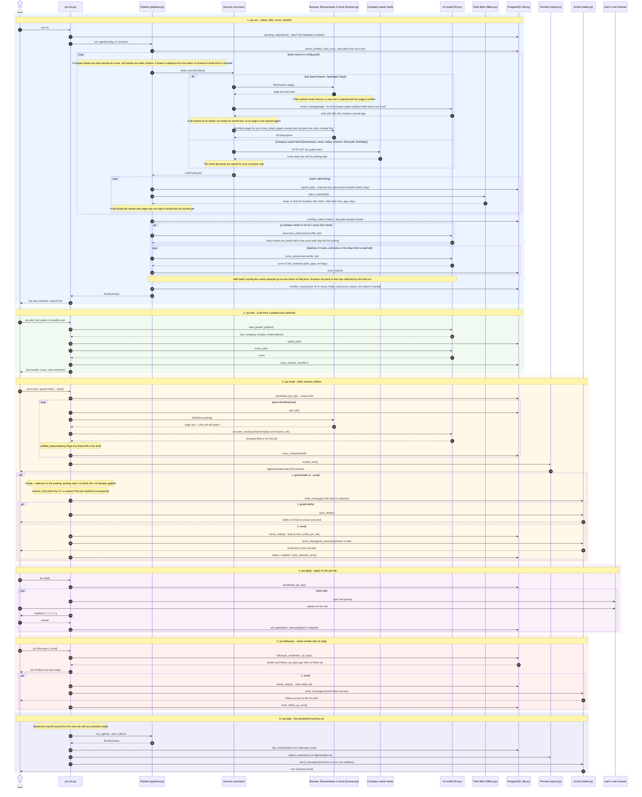

# Architecture

How the job search agent works from end to end. For what each command does, see
[GUIDE.md](GUIDE.md). For pictures you can open in a browser, see `app-flow.html` (flowchart) and
`architecture-live.html` (animated).

## Full application flow

The diagram follows one job from being found to being followed up. It has six parts, one per
command: `jsa run`, `jsa add`, `jsa email`, `jsa apply`, `jsa followups` and `jsa daily`. The parts
share only the database: each one reads what an earlier one stored.

Not in the diagram:

- `jsa web` (or the Job Search app) is a separate, long-running page: `web.py` serves
  `static/app.html`, the stylesheet and six scripts beside it, and a JSON API on
  `http://127.0.0.1:8765`. Quick changes (status, notes, saving
  or sending one draft) happen in the request. Anything slow is started as a `jsa` child process by
  `TaskRunner`, one at a time; so the page runs exactly the same code as the terminal commands.
  Each open page holds one long-lived connection (`/api/events`, Server-Sent Events) over which
  the program pushes every line a task prints and a note whenever something stored changed; a page
  that cannot hold it goes back to asking every few seconds. The page talks to the API with a key written into it when it
  loads, and the server answers only on this machine. **Stop** sends the child a terminate
  signal and ends it outright if it has not finished tidying up after 15 seconds.
  [DESIGN.md](DESIGN.md) records how the page looks and reads.
- `jsa contacts` runs between parts 1 and 3: the AI web-searches for a published application
  address, `contacts.py` verifies it on the company's page, and `save_contact()` stores it for
  `jsa email` to use.
- `jsa add-contacts` stores HR addresses that have no posting as general applications; `jsa email`
  drafts them from their own template, writing the email once for each country and reusing it.
- `jsa send` delivers drafts that are already saved, without writing them again; the page uses it.
- `jsa cover-letter` fills in the cover letter template for one job.
- `jsa score` is part 1 without the collecting: `run_agent(collect=False)` takes the stored jobs
  that pass the rule filters and were never scored (`waiting_jobs()`), and scores them under the
  same cap and spending limits.
- `jsa delete` removes a job the person added by hand, if it has not been emailed.
- `jsa gaps`, `jsa progress` and `jsa dedupe` only read (or tidy) the database.
- After `jsa run` and `jsa daily`, `notifier.py` sends jobs scoring `notify_min_score` or more to
  Telegram or email.

## Reading the diagram

| Part | Command | What it leaves behind |
|---|---|---|
| 1 | `jsa run` | Jobs, scores and a shortlist in the database |
| 2 | `jsa add` | One more shortlisted job, from text you pasted |
| 3 | `jsa email` | A draft per job, an HTML preview, and optionally Gmail drafts or sent emails |
| 4 | `jsa apply` | The status of each job you applied to on its site |
| 5 | `jsa followups` | A follow-up sent, and recorded, for each email that got no reply |
| 6 | `jsa daily` | Part 1, plus a digest file and one summary email to you |

## The pieces

| Piece | File | Role |
|---|---|---|
| `jsa` commands | `src/jobagent/cli.py` | Reads the command and drives everything else |
| Pipeline | `src/jobagent/pipeline.py` | One run: collect, store, filter, score, shortlist, within the spending limits |
| Sources | `src/jobagent/sources/` | Job boards through the browser (`generic.py`); company career feeds over plain HTTP (`ats.py` for Greenhouse, Lever and Ashby; `big.py` for Amazon, Microsoft and Workday) |
| Browser | `src/jobagent/browser.py` | A Browserbase session, or local Chromium, behind one `fetch()`; each job board can name which, and one is started only when a board needs it; counts the minutes used, Browserbase's separately |
| AI model | `src/jobagent/llm.py`, `llm_anthropic.py` | Every AI task: read pages, score jobs, read pasted posts, draft emails, with the resume and template sent as a cached prefix |
| Rule filters | `src/jobagent/filters.py` | Free checks before any AI call |
| Database | `src/jobagent/db.py`, `migrations/` | PostgreSQL: jobs, scores, applications, send times, runs |
| Preview | `src/jobagent/report.py` | Terminal tables, the Markdown digest, the HTML email preview |
| Gmail | `src/jobagent/mailer.py` | Builds the message; saves it to Drafts or sends it |
| Web app | `src/jobagent/web.py`, `static/`, `Job Search.app` | Every command as a button: a JSON API, a runner that executes `jsa` commands as tasks, and a double-click launcher. The page is `app.html` with `app.css` and six plain scripts loaded in order (`base`, `chrome`, `lists`, `drawer`, `pages`, `actions`); the key the page sends with each request is written into `app.html` only |
| Costs | `src/jobagent/costs.py` | What a run's AI calls cost, from the token counts of each model and a price list; also the dollar limit for one run |
| CV for one job | `src/jobagent/tailor.py` | Checks the CV the model wrote against the resume text, takes out what the resume does not say, and prints the rest to a PDF |
| Replies | `src/jobagent/replies.py` | A read-only look in the Gmail inbox for answers to sent emails: sender, date and subject line only |
| Pictures | `tools/take_screenshots.py` | Retakes every picture in `screenshots/` on a demo copy with made-up data, and checks the words in them before replacing the old ones |
| Shared actions | `src/jobagent/actions.py` | Add a pasted job, add HR addresses and send a stored draft, used by both the commands and the web page |
| Contact check | `src/jobagent/contacts.py` | Confirms a found application address is printed on the company's own page |
| Notifications | `src/jobagent/notifier.py` | Sends strong new matches to Telegram, or to your own email |
| Schedule | `src/jobagent/scheduler.py` | The macOS launchd job that runs `jsa daily` each morning |
| Backup | `src/jobagent/backup.py` | A `pg_dump` copy of the database and a git bundle of the code, keeping the newest few |
| Data shapes | `src/jobagent/models.py` | `JobPosting`, the keys for matching a job across boards, and the AI's structured answers |
| Settings | `src/jobagent/config.py` | `.env` secrets and `config.yaml`, including limits and CV variants, plus the settings changed on the page, kept apart in `config.overrides.yaml` |

## Design points

- **`JobPosting` is the one shape a job takes.** Sources create it, filters read it, the database
  stores it, and the AI scores it.
- **Every AI task lives in `BaseLLM`.** The Claude and OpenAI classes only supply how to call each
  provider, so one line in `.env` switches between them.
- **The parts meet only in the database.** That is why a job added with `jsa add` can be emailed
  without a run, and why re-running never scores or emails a job twice.
- **One job, one row.** A job is identified by its company (without "Pvt Ltd" and similar), the
  meaningful words of its title, and its country, so the same job on two boards is stored once.
- **Sites are read side by side.** Company career feeds are plain HTTP, so six are read at the
  same time on worker threads while the job boards go one after another in the browser. Only the
  run's own thread touches the database and the browser: a feed's results and log lines are
  handed back and stored in the order of the settings, whichever answered first.
- **Spending is bounded.** A run stops reading job boards at the browser-minute limit and stops scoring at
  the token limit; what is left waits for the next run.
- **Nothing reaches a recruiter by accident.** A draft is saved before delivery is attempted,
  delivery happens only with `--gmail-drafts` or `--send`, and sending stops at the daily cap.
  A job is emailed once; a second email needs **Send again** on that one job, after a question
  that names the address and the first date. What the program records about a send or a status
  change goes to the job's history and never over the notes the person wrote.
- **Addresses are found, never guessed.** `jsa contacts` asks the AI to search, but an address is
  stored only after `contacts.py` fetches the page itself and finds the address printed there.
- **A run always gets an end.** A terminate signal is handled like Ctrl-C, so a stopped run
  shortlists what it scored and records where it ended. A run also holds a PostgreSQL advisory lock
  while it works; the lock goes when its program does, so a row still marked running with no lock
  is known to be dead and is closed the next time runs are listed or a run starts. A run that is
  only partly finished stores the reason: the limit reached, or the sites that could not be read.
- **The database must be current.** Every command checks for pending updates first and says
  "Run: jsa migrate" instead of failing halfway; the page offers a button for the same.
- **A job is read before it is scored.** A job board's list gives a title, a company and a place.
  Until the job's own page has been opened the job is stored but not scored, and it waits for a
  later run. The search hands each board the stored copy of every job it lists again, so a page is
  opened once and a job does not look changed because its list line was read differently.
- **Scoring is paid for once, and as little as needed.** A cheaper model can read the job-site
  pages (a page it cannot read goes to the main model) and can rule out the clear misses before the
  full scoring, and the scoring can go as one batch at half price. A batch is
  recorded in `run_events` before the run waits for it, so if the wait runs out or the run is
  stopped, the next run collects the answers, and its jobs are not sent again meanwhile.
- **What the model writes about you is checked against your resume.** A CV for one job goes
  through `tailor.check` before it is saved: a skill or employer the resume does not name, and a
  line with a figure the resume does not give, are removed and listed. The email keeps your usual
  CV until you switch the written one on.
- **The mailbox is only read, and only when asked.** `replies.py` opens the inbox read-only and
  fetches header lines with `BODY.PEEK`, so nothing is marked as read; it is off by default, and it
  never changes a job's status.
- **Spending is counted in money as well as tokens.** Each AI client keeps its tokens by kind, a
  batch's apart, and `costs.py` turns them into dollars for the run's record and for the limit.
- **The page is told; it does not keep asking.** One counter moves when a task prints or changes
  state, another when anything stored changes, and every open page waits on both.
- **Settings changed on the page never rewrite your file.** They are stored beside `config.yaml`
  and laid over it whenever any command loads the settings.
- **The page is tested in a real browser.** `tests/test_page.py` opens it in Chromium against a
  throwaway database, with a stand-in for the `jsa` commands.
- **A site that refuses is reported, never read as empty.** A closed connection, an "Access
  Denied" answer or a bot check raises `SiteRefused` in `browser.py` before any AI call. The run
  names the site as not read, and a board that refuses a job page is asked for no more pages in
  that run. Nothing tries to get past a refusal.
- **The agent never logs in to job sites.** They block automated browsers, so applying on a site
  is done by you in your own browser.
