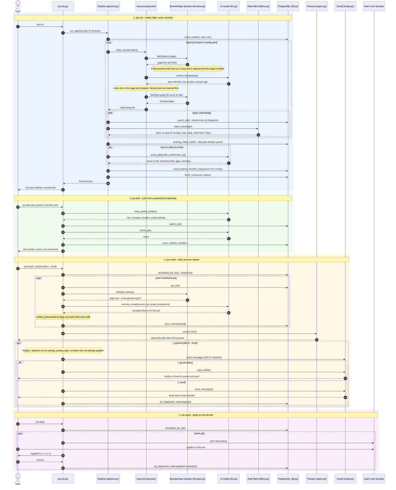

# Architecture

How the job search agent works from end to end. For what each command does, see
[GUIDE.md](GUIDE.md).

## Full application flow

The diagram follows one job from being found to being applied for. It has four parts, one per
command you run: `jsa run`, `jsa add`, `jsa email` and `jsa apply`. The parts share only the
database: each one reads what an earlier one stored.

## Reading the diagram

| Part | Command | What it leaves behind |
|---|---|---|
| 1 | `jsa run` | Jobs, scores and a shortlist in the database |
| 2 | `jsa add` | One more shortlisted job, from text you pasted |
| 3 | `jsa email` | A draft per job, an HTML preview, and optionally Gmail drafts or sent emails |
| 4 | `jsa apply` | The status of each job you applied to on its site |

## The pieces

| Piece | File | Role |
|---|---|---|
| `jsa` commands | `src/jobagent/cli.py` | Reads the command and drives everything else |
| Pipeline | `src/jobagent/pipeline.py` | One run: collect, store, filter, score, shortlist |
| Sources | `src/jobagent/sources/` | Job boards through the browser (`generic.py`); company boards through public feeds (`ats.py`) |
| Browser | `src/jobagent/browser.py` | A Browserbase session, or local Chromium, behind one `fetch()` |
| AI model | `src/jobagent/llm.py`, `llm_anthropic.py` | Every AI task: read pages, score jobs, read pasted posts, draft emails |
| Rule filters | `src/jobagent/filters.py` | Free checks before any AI call |
| Database | `src/jobagent/db.py`, `migrations/` | PostgreSQL: jobs, scores, applications, runs |
| Preview | `src/jobagent/report.py` | Terminal tables, the Markdown digest, the HTML email preview |
| Gmail | `src/jobagent/mailer.py` | Builds the message; saves it to Drafts or sends it |
| Data shapes | `src/jobagent/models.py` | `JobPosting` and the AI's structured answers |
| Settings | `src/jobagent/config.py` | `.env` secrets and `config.yaml` |

## Design points

- **`JobPosting` is the one shape a job takes.** Sources create it, filters read it, the database
  stores it, and the AI scores it.
- **Every AI task lives in `BaseLLM`.** The Claude and OpenAI classes only supply how to call each
  provider, so one line in `.env` switches between them.
- **The four parts meet only in the database.** That is why a job added with `jsa add` can be
  emailed without a run, and why re-running never scores or emails a job twice.
- **Nothing reaches a recruiter by accident.** A draft is saved before delivery is attempted, and
  delivery happens only with `--gmail-drafts` or `--send`.
- **The agent never logs in to job sites.** They block automated browsers, so applying on a site
  is done by you in your own browser.
